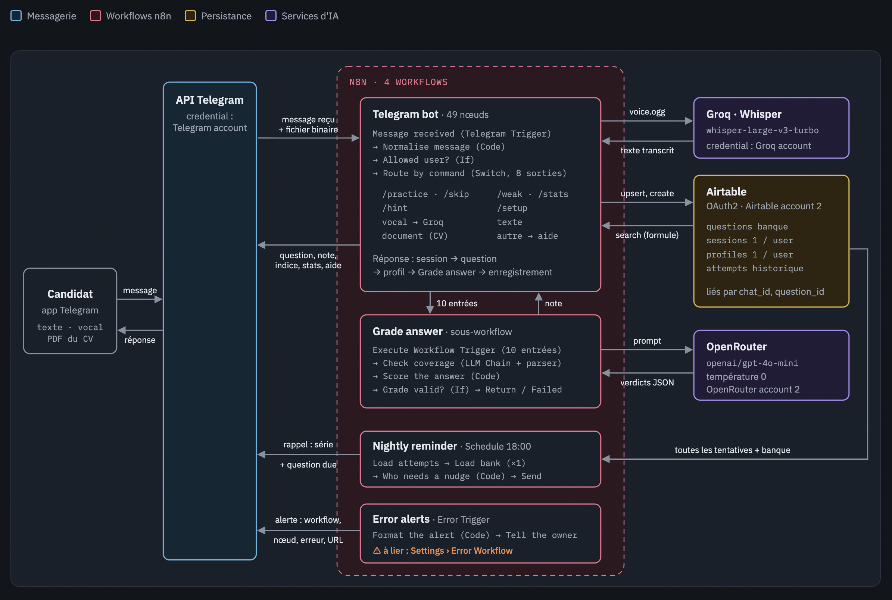
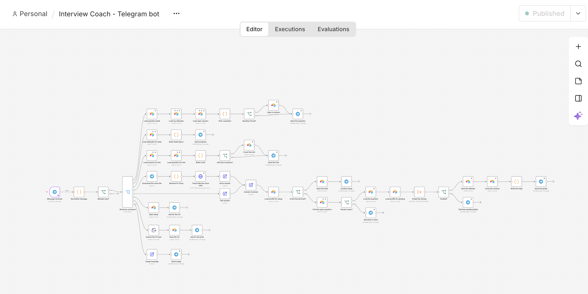
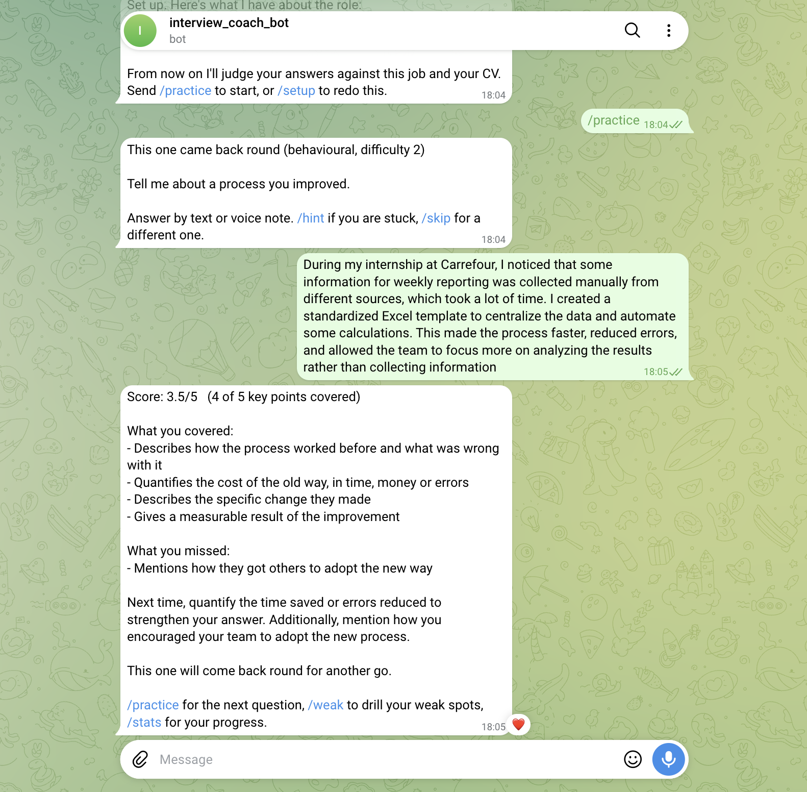

# Interview Coach

Bot Telegram d'entraînement aux entretiens, construit avec n8n.

**Le besoin.** Un candidat qui prépare un entretien s'entraîne seul, en relisant des listes de questions, sans personne pour lui dire objectivement ce qui manque dans ses réponses.

**La solution.** Le bot pose des questions adaptées aux points faibles du candidat, accepte des réponses écrites ou vocales, les fait vérifier par un LLM contre une grille fixe, calcule une note sur 5, reprogramme les questions ratées et relance le candidat chaque soir.



## Fonctionnement

| Workflow | Rôle | Déclencheur |
|---|---|---|
| `Interview Coach - Telegram bot` | Reçoit chaque message et l'oriente (Switch, 8 sorties) | Telegram Trigger |
| `Interview Coach - Grade answer` | Sous-workflow de notation : le LLM juge la couverture de chaque point, le code calcule la note | Execute Workflow Trigger |
| `Interview Coach - Nightly reminder` | Relance les candidats qui ne se sont pas entraînés aujourd'hui | Schedule, 18:00 |
| `Interview Coach - Error alerts` | Envoie une alerte Telegram (workflow, nœud, erreur, lien d'exécution) en cas d'échec | Error Trigger |

Services externes :

| Service | Usage | Credential n8n |
|---|---|---|
| Telegram Bot API | Recevoir et envoyer les messages | `Telegram account` |
| Airtable | Persistance (4 tables) | `Airtable account 2` (OAuth2) |
| Groq (Whisper `whisper-large-v3-turbo`) | Transcription des notes vocales | `Groq account` |
| OpenRouter (`openai/gpt-4o-mini`, température 0) | Vérification de la couverture de la grille | `OpenRouter account 2` |

## Commandes du bot

| Commande | Effet |
|---|---|
| `/practice` | Une question, pondérée vers les thèmes faibles ; les questions à revoir passent en priorité |
| `/practice <thème>` | Une question d'un thème : behavioural, motivation, technical, company-fit, competency, case |
| `/practice weak` | Une question parmi les 3 thèmes les plus faibles |
| `/hint` | Révèle un point de la grille (−0,5 sur la note) |
| `/skip` | Une autre question |
| `/weak` | Les 3 thèmes les plus faibles sur 14 jours |
| `/stats` | Nombre de réponses, moyenne, moyenne par thème, série de jours |
| `/setup` | Envoi du CV (PDF) puis description du poste, utilisés pour noter |
| texte ou note vocale | Réponse à la question ouverte |

## Installation

Le projet tourne sur **n8n Cloud** : aucun serveur à installer, et n8n fournit directement l'URL HTTPS publique dont le webhook Telegram a besoin.

### Prérequis

- Un compte [n8n Cloud](https://n8n.io/)
- Un bot Telegram créé avec [@BotFather](https://t.me/BotFather)
- Des clés API [Groq](https://console.groq.com/) et [OpenRouter](https://openrouter.ai/), un compte [Airtable](https://airtable.com/)

### 1. Cloner le dépôt

```bash
git clone https://github.com/AlixBauret28/interview-coach.git
```

### 2. Importer les workflows

Dans n8n : **Create workflow** → menu **…** → **Import from File**, puis choisis un fichier du dossier `workflows/`. Répète pour les quatre. Importe *Grade answer* et *Error alerts* en premier : les deux autres y font référence.

Après l'import, vérifie dans *Grade the answer* (Telegram bot) que le sous-workflow sélectionné est bien *Interview Coach - Grade answer*, et dans les **Settings** de chaque workflow que l'Error Workflow est *Interview Coach - Error alerts*.

### 3. Créer les credentials

Dans n8n, menu **Credentials**, crée les quatre credentials du tableau ci-dessus avec ces noms exacts. Ouvre ensuite chaque workflow, resélectionne le credential sur les nœuds signalés en rouge, puis **Publish**.

### 4. Préparer Airtable

Crée une base avec quatre tables (les ID de base et de tables sont à reporter dans les nœuds Airtable) :

| Table | Champs | Rôle |
|---|---|---|
| questions | `question_id`, `text`, `topic`, `difficulty` (nombre), `key_points` (texte JSON : `["point 1", "point 2"]`), `active` (case à cocher) | Banque de questions, remplie à la main |
| sessions | `chat_id`, `question_id`, `status` (`open`/`closed`), `started_at`, `hints_used` | Question en cours, une ligne par utilisateur |
| profiles | `chat_id`, `cv_text`, `job_brief`, `setup_stage`, `updated_at` | CV et poste, une ligne par utilisateur |
| attempts | `chat_id`, `question_id`, `topic`, `answer`, `covered`, `score`, `created_at`, `due_at`, `input_mode` | Historique des réponses notées |

Les tables sont reliées par `chat_id` et `question_id`.

### 5. Autoriser ton compte Telegram

Envoie un message à [@userinfobot](https://t.me/userinfobot) pour connaître ton chat ID, puis reporte-le dans :
- `ALLOWED_CHAT_IDS`, nœud *Normalise message* (Telegram bot)
- `ADMIN_CHAT_ID`, nœud *Format the alert* (Error alerts)

## Tester

**Sans Telegram.** Le nœud *Message received* contient un message d'exemple épinglé (pin data). Dans l'éditeur du workflow Telegram bot, clique **Execute workflow** : le message est rejoué de bout en bout. Les données épinglées sont ignorées en production.

**Aller-retour complet.** Sur Telegram : `/practice`, réponds par texte ou note vocale, tu reçois la note. Puis `/stats`.

**Chemin d'erreur.** Dans *Transcribe the voice note*, modifie l'URL (ex. `.../transcriptionsX`), publie, envoie une note vocale : l'alerte arrive sur Telegram avec le lien de l'exécution. Remets l'URL correcte.

**Entrée invalide.** `/bonjour` renvoie l'aide ; `/practice cuisine` renvoie la liste des thèmes valides.

## Robustesse

- **Retry On Fail** (3 essais, 2 s d'attente) sur chaque appel externe : Airtable, Telegram, Groq, OpenRouter.
- **Error Workflow** lié dans les settings des trois workflows.
- **Sortie IA validée** : Structured Output Parser, puis vérification en code que chaque citation figure dans la réponse ; sinon branche *Grading failed* et rien n'est enregistré.
- **Idempotence** : sessions et profils en upsert sur `chat_id` ; une réponse envoyée deux fois n'est notée qu'une fois, la session étant fermée après la première.

## Structure du dépôt

```
.
├── README.md
├── .gitignore
├── workflows/             exports JSON des 4 workflows
└── docs/
    ├── architecture.png   schéma d'architecture
    └── screenshots/       captures du bot et des workflows
```

## Sécurité

Aucun secret n'est versionné : les exports de workflows ne contiennent que le nom et l'identifiant des credentials, jamais les clés. Les clés sont stockées chiffrées dans n8n.

## Captures



